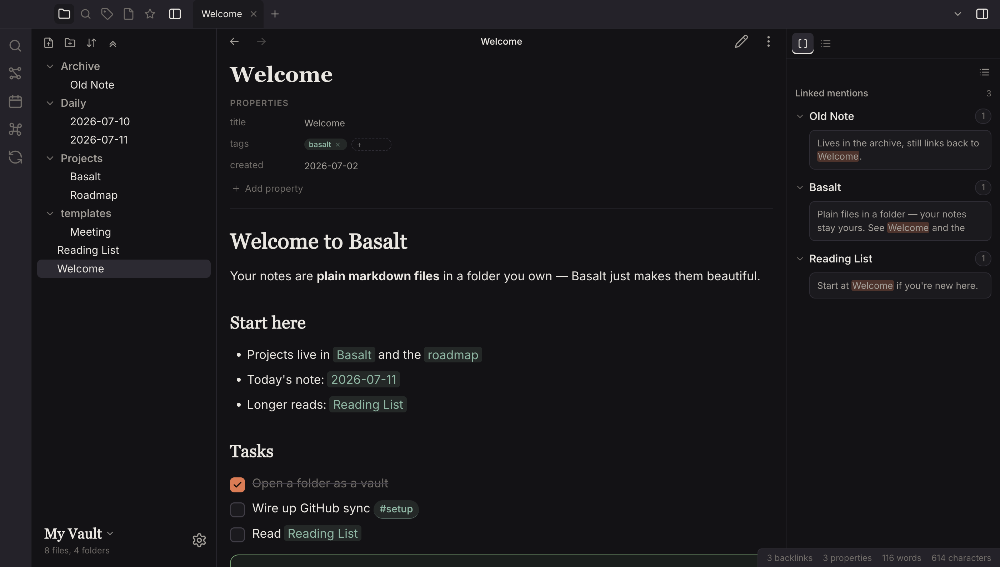
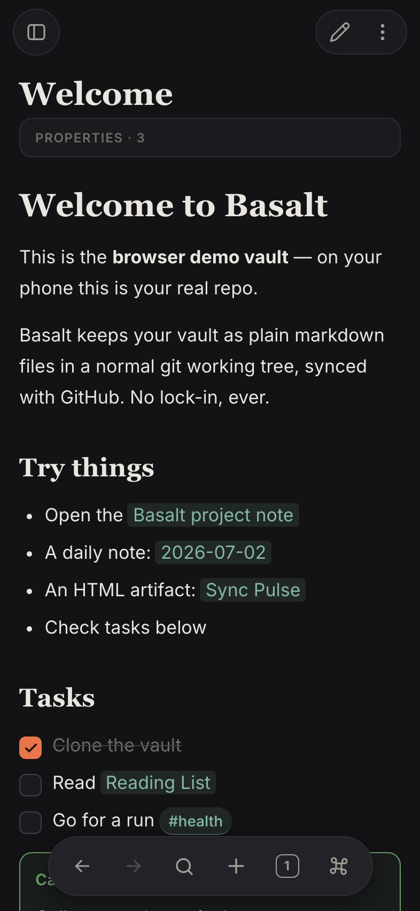
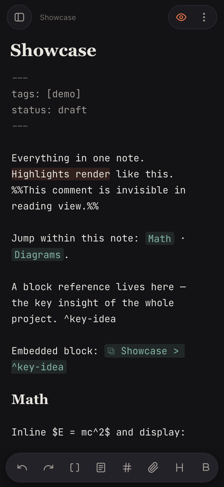
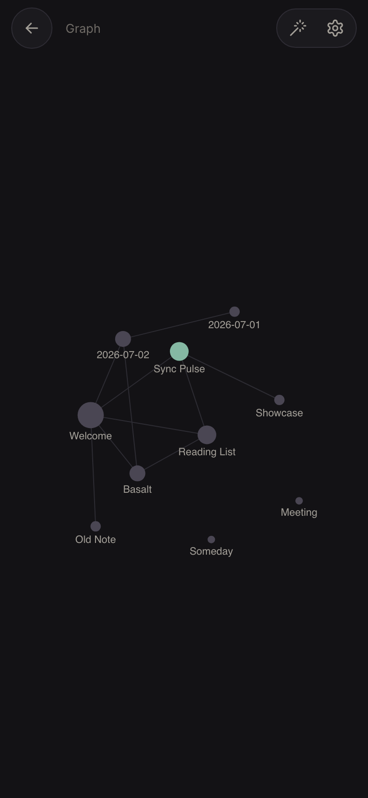
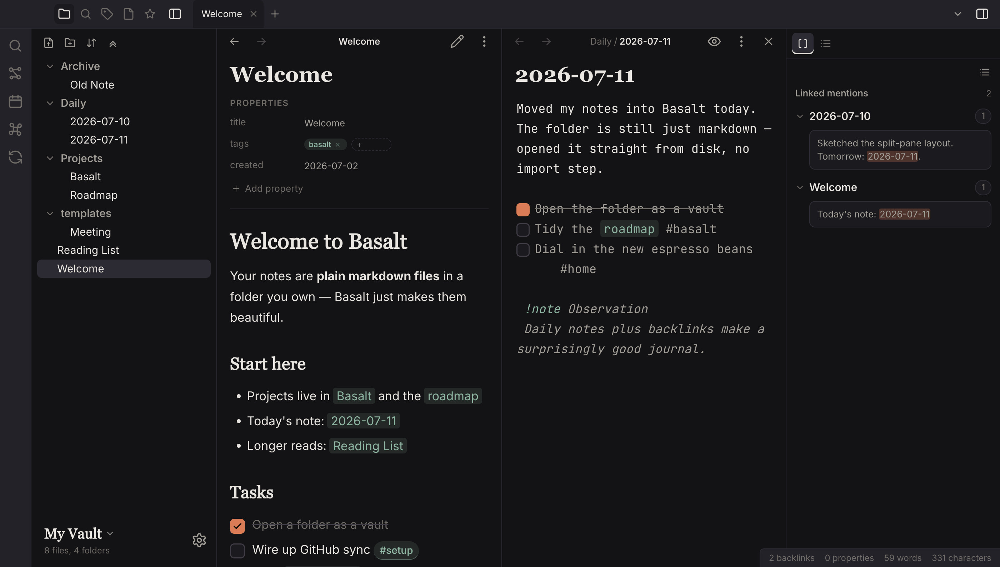
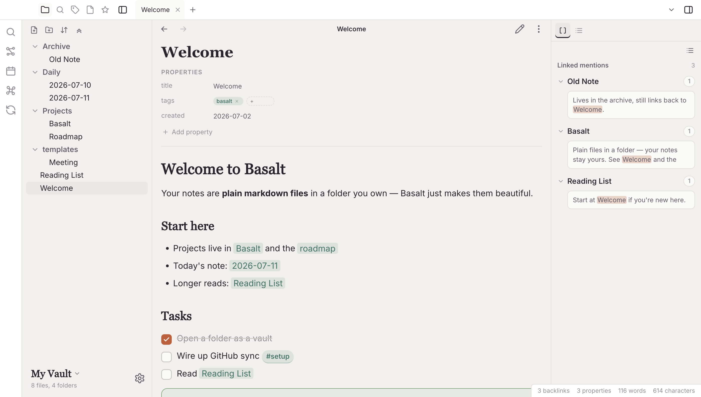

<div align="center">

# Basalt

**A markdown vault that feels great on your phone and your Mac.**

Wikilinks, backlinks, a living graph, a fast editor — on top of plain `.md` files
in a folder you own. Synced with git. No accounts, no database, no lock-in.

</div>



## Your notes stay yours

A Basalt vault is a normal folder of markdown files, in the same format Obsidian
uses. On Android it's a real git working tree synced with GitHub; on Mac it can be
any folder on your disk. Delete the app tomorrow and your notes are still just
files — readable anywhere, versioned by git.

- **Plain markdown, fully rendered.** Wikilinks, `![[embeds]]`, callouts, tags,
  tasks, properties, tables, code highlighting, LaTeX math, Mermaid diagrams.
  Even `.html` files in the vault render sandboxed, scripts and all.
- **Connected thinking.** Backlinks with surrounding context, an interactive
  graph of your vault, `[[` autocomplete, quick open, full-text search.
- **Sync that never loses a word.** Edits commit automatically. A real conflict
  keeps *both* versions — yours is saved next to the incoming one as
  `Note (conflict …).md` — instead of silently overwriting either.
- **Offline-first.** Everything works with no connection; sync catches up when
  you're back.

## On your phone

Basalt on Android is built for one-handed capture and comfortable reading:
dark-first design, hardware back button, swipe-open sidebars, and a CodeMirror 6
editor with a formatting toolbar and live preview.

| Reading view | Editor | Graph |
| --- | --- | --- |
|  |  |  |

Point it at a GitHub repo once — after that, notes commit as you write, pull
when you open the app, and push after a quiet period. Your vault history is a
normal git log you can inspect from any machine.

## On your Mac

The desktop app grows into the space: docked file tree and backlink sidebars,
tabs, split panes for working in two notes at once, and per-note version
history with diffs.



Vaults are flexible on Mac:

- **Open any folder as a vault.** No import, no copy — Basalt reads and writes
  the markdown that's already there.
- **Choose how it syncs.** If the folder is a git repo with a remote, Basalt can
  sync it using the credentials your command-line git already has (SSH keys,
  credential helpers) — no tokens to paste. Or keep it **local-only** and Basalt
  never touches git at all.

## Dark first, light always

Every screen ships in both themes — the light mode is a design, not an invert.



## Try it in your browser

The whole app runs in a browser with a demo vault and a mock sync engine:

```bash
git clone https://github.com/danieloflynn/basalt && cd basalt
npm install
npm run dev    # open the printed URL, connect the fake repo, look around
```

### Build for Mac

```bash
npm run electron:pack    # dmg lands in release/ (x64)
```

### Build for Android

```bash
npm run build && npx cap sync android
cd android && JAVA_HOME=<jdk21> ./gradlew assembleDebug
adb install app/build/outputs/apk/debug/app-debug.apk
```

Then on the phone: create a GitHub **fine-grained personal access token**
scoped to your vault repo (Contents: read & write), open Basalt → *Connect a
repository* → paste `owner/repo` and the token, pick a branch. The vault
clones and you're in.

## Under the hood

```
React + TypeScript UI (webview / Electron renderer)
  CodeMirror 6 editor · remark/rehype renderer
────────────────────────────────────────────────────
Services (TS): VaultService (files → tree/index/search)
               SyncService  (commit → fetch → merge → push)
────────────────────────────────────────────────────
GitEngine interface (TS)
  ├─ browser: mock engine + in-memory FS (dev, demo)
  ├─ Android: BasaltGit Capacitor plugin (Kotlin + JGit)
  └─ Mac:     Electron main process (isomorphic-git,
              or your system git for folder vaults)
────────────────────────────────────────────────────
Vault = a plain folder / git working tree on disk
```

The UI never talks to git directly — `GitEngine` (`src/engine/types.ts`) is the
only doorway. On Android it's a Capacitor plugin wrapping JGit, with the GitHub
token in Android-Keystore-backed storage. On Mac, network operations for folder
vaults shell out to your system `git`, so authentication behaves exactly like
your terminal.

```bash
npm test               # vitest unit tests (domain layer)
npm run test:visual    # Playwright pixel tests of every screen
npm run build          # typecheck + production bundle
```
